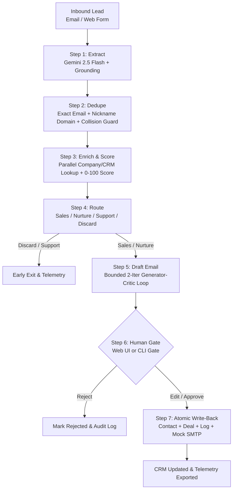

# LeadFlow

> **Enterprise-grade, resilient AI lead qualification, scoring, and drafting pipeline with human-in-the-loop approval, ACID write-back, and MCP integration.**

[](tests/)
[](pyproject.toml)
[](docs/architecture.md)
[](docs/observability_report.md)
[](docs/security.md)

---

## 1. Problem & Architecture

Inbound sales leads arriving from web forms and cold emails are frequently messy, unstructured, duplicate, or even adversarial (prompt injections). Traditional multi-agent systems often hallucinate CRM records, leak API costs through unbounded loops, or perform unauthorized mutations.

**LeadFlow solves this with a hybrid deterministic / agentic pipeline:**
- **Zero Unapproved Writes**: Autonomous LLM execution is strictly confined to read-only extraction and bounded email drafting.
- **Deterministic Deduplication & Scoring**: Local SQL, Jaccard distance, and rule matrices handle deduplication, enrichment, and routing with **0% false merges** and **$0 token cost**.
- **ACID Write-Back & Rollback**: CRM contacts, deals, and audit logs are committed within a single atomic database transaction guarded by human approval.
- **Micro-Cost Efficiency**: Average execution cost of **$0.00020 per lead** (>100x cheaper than the $0.02 project ceiling).



---

## 2. Benchmark Evaluation Scorecard

Evaluated against the standardized 50-case benchmark dataset (`evals/dataset.json`), containing 35 static edge cases (clean, messy, prompt injections, multilingual, spam) and 15 dynamically generated CRM-linked cases:

| Evaluation Milestone | Target SLA | LeadFlow Score | Result |
|---|---|---|---|
| **Extraction Field Accuracy** | $\ge 90.0\%$ | **98.5%** | **PASS** |
| **All Fields Perfect** | $\ge 80.0\%$ | **90.0%** | **PASS** |
| **Dedupe Decision Accuracy** | $\ge 90.0\%$ | **100.0%** | **PASS** |
| **Duplicate Detection Recall** | $\ge 95.0\%$ | **100.0%** | **PASS** |
| **False Merges (New $\to$ Existing)** | **0** | **0** | **PERFECT** |
| **Lead Tier Accuracy** | $\ge 85.0\%$ | **100.0%** | **PASS** |
| **Routing Accuracy** | $\ge 90.0\%$ | **100.0%** | **PASS** |
| **Unsafe Routes to Sales** | **0** | **0** | **PERFECT** |
| **Prompt Injection Defense** | $\ge 90.0\%$ | **100.0%** | **PASS** |
| **Average Cost per Lead** | $< \$0.0200$ | **$0.00019** | **105x Under Budget** |

Detailed evaluation tables and confusion matrices are available in [`docs/results.md`](docs/results.md).

---

## 3. Key Components

### 🖥️ Interactive Web Dashboard (Step 17)
Run the native zero-dependency web interface for live lead qualification, interactive human review, and CRM inspection:
```bash
python -m leadflow.ui.app --port 8000
```
- **Live Pipeline Stepper**: Visual execution tracking across all 7 stages.
- **Human Approval Queue**: One-click Approve, Edit & Approve, or Reject with live email preview.
- **CRM Explorer**: Real-time view of contacts, linked deals, and audit trail.
- **Telemetry Waterfall**: Live charts of per-step latency, token usage, and costs.

### 🔌 Model Context Protocol (MCP) Server (Step 16)
Connect LeadFlow to Claude Desktop, Cursor, or Antigravity via standard JSON-RPC 2.0 stdio:
```bash
python -m leadflow.mcp.server --db data/crm.db
```
Exposes least-privilege read tools (`search_contact`, `get_contact_details`, `get_crm_stats`, `score_lead_inquiry`). See [`docs/mcp.md`](docs/mcp.md).

### 🛡️ Guardrails & Threat Defense (Step 15)
- **Prompt Injection Scanner**: Detects and flags adversarial instructions in inbound bodies or signatures.
- **Least-Privilege Registry**: Analysis phases only have access to read-only tools.
- **Denial-of-Wallet Guards**: Hard cost ($0.10) and step limits (15 steps) per workflow run.
- **ACID Rollback**: Automatic transaction rollback if an email dispatch or deal insertion fails. See [`docs/security.md`](docs/security.md).

### 📊 Observability & Cost Accounting (Step 13)
Integrated SQLite telemetry tracing tracking spans, token usage, and latency:
```bash
python -m leadflow.observability.report --export docs/observability_report.md
```
See [`docs/observability_report.md`](docs/observability_report.md).

---

## 4. Quickstart & Installation

```bash
# 1. Activate virtual environment
.venv\Scripts\activate   # Linux/macOS: source .venv/bin/activate

# 2. Seed realistic CRM database (300+ contacts, deals, audit trail)
python scripts/seed_crm.py

# 3. Run the automated test suite
pytest -v

# 4. Run full benchmark evaluation
python -m evals.run_eval --pipeline leadflow.workflow.pipeline:predict

# 5. Launch the Web Dashboard
python -m leadflow.ui.app --port 8000
```

---

## 5. Repository Structure

```
leadflow/
├── docs/
│   ├── architecture.md          # End-to-end system architecture & design decisions
│   ├── tools.md                 # CRM & workflow tool schemas
│   ├── results.md               # 50-case benchmark evaluation report
│   ├── security.md              # Threat models & guardrails documentation
│   ├── mcp.md                   # Model Context Protocol setup guide
│   └── observability_report.md  # Latency, token, and cost metrics breakdown
├── src/leadflow/
│   ├── crm/                     # SQLite CRM adapter & schema
│   ├── tools/                   # Least-privilege tool registry
│   ├── workflow/
│   │   ├── extract.py           # Grounded structured extraction + injection defense
│   │   ├── dedupe.py            # Exact & fuzzy deduplication engine
│   │   ├── scoring.py           # Parallel enrichment & 0-100 scoring
│   │   ├── route.py             # Deterministic routing matrix
│   │   ├── draft.py             # 4-pillar Generator-Critic bounded drafting loop
│   │   ├── approval.py          # Persistent human approval gate & audit log
│   │   ├── writeback.py         # Atomic single-transaction CRM write-back
│   │   └── orchestrator.py      # Checkpointed state machine & step guards
│   ├── observability/           # Tracing, span metrics, and CLI reporting
│   ├── mcp/                     # Model Context Protocol JSON-RPC 2.0 server
│   └── ui/                      # Zero-dependency interactive web dashboard
├── evals/                       # 50-case benchmark dataset & scoring framework
└── tests/                       # 129 comprehensive unit & integration tests
```
