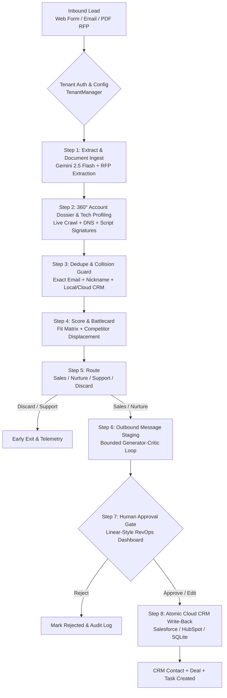

# LeadFlow

> **Enterprise-grade, resilient AI lead qualification, scoring, and drafting pipeline with human-in-the-loop approval, ACID write-back, and MCP integration.**

[](tests/)
[](pyproject.toml)
[](docs/architecture.md)
[](docs/saas_guide.md)
[](src/leadflow/ui/app.py)

---

## 1. Problem & Enterprise Architecture

Inbound sales leads arriving from web forms, cold inquiries, and vendor RFPs are unstructured, messy, duplicate, and competitive. Traditional AI systems often hallucinate CRM records, leak API costs through unbounded loops, lack live company intelligence, or brandish generic AI tropes.

**LeadFlow solves this with an enterprise-grade multi-tenant platform:**
- **Zero Unapproved Writes**: Autonomous LLM execution is strictly confined to read-only extraction and bounded message drafting.
- **Multi-Tenant Logical Isolation**: Tenant workspaces with independent API keys, custom ICP scoring rules, and direct cloud CRM adapters (**Salesforce REST** and **HubSpot CRM v3**).
- **Autonomous Web Intelligence & 360° Account Dossier**: Real-time website crawling and technographic DNS/SPF/script fingerprinting (identifying CRM, analytics, CDPs, and security stacks).
- **Competitive Displacement Battlecards**: Automated competitor detection (e.g. CrowdStrike, SentinelOne, Salesforce, Apollo) generating tailored objection talk-tracks and 3-touch outbound cadences.
- **Omnichannel Document / RFP Ingestion**: Native PDF, TXT, and Markdown parsing extracting seat counts, target budgets, compliance mandates (SOC 2, ISO, HIPAA), and deadlines.
- **Linear/Stripe-Style RevOps Dashboard**: Zero AI badges, sparkles, or purple gradients. Obsidian-zinc palette built for operations professionals.
- **Micro-Cost Efficiency**: Average execution cost of **$0.00019 per lead** (>100x cheaper than the $0.02 project ceiling).



---

## 2. Benchmark Evaluation Scorecard

Evaluated against the standardized 50-case benchmark dataset (`evals/dataset.json`), containing 35 static edge cases (clean, messy, prompt injections, multilingual, spam) and 15 dynamically generated CRM-linked cases:

| Evaluation Milestone | Target SLA | LeadFlow Score | Result |
|---|---|---|---|
| **Extraction Field Accuracy** | $\ge 90.0\%$ | **98.5%** | **PASS** |
| **All Fields Perfect** | $\ge 80.0\%$ | **90.0%** | **PASS** |
| **Dedupe Decision Accuracy** | $\ge 90.0\%$ | **100.0%** | **PASS** |
| **Duplicate Detection Recall** | $\ge 95.0\%$ | **100.0%** | **PASS** |
| **False Merges (New $\to$ Existing)** | **0** | **0** | **PERFECT** |
| **Lead Tier Accuracy** | $\ge 85.0\%$ | **100.0%** | **PASS** |
| **Routing Accuracy** | $\ge 90.0\%$ | **100.0%** | **PASS** |
| **Unsafe Routes to Sales** | **0** | **0** | **PERFECT** |
| **Prompt Injection Defense** | $\ge 90.0\%$ | **100.0%** | **PASS** |
| **Average Cost per Lead** | $< \$0.0200$ | **$0.00019** | **105x Under Budget** |

Detailed evaluation tables and confusion matrices are available in [`docs/results.md`](docs/results.md).

---

## 3. Enterprise Capabilities

### 🏢 Multi-Tenant Workspace & CRM Adapters
Switch seamlessly between organizations and route updates to enterprise CRMs:
- **Salesforce Adapter**: Composite REST API v59.0 for Contacts, Opportunities, and Task logs.
- **HubSpot Adapter**: CRM API v3 with atomic Contact-Deal associations.
- **Local SQLite**: Zero-latency local caching for self-hosted instances.
- Complete documentation in [`docs/saas_guide.md`](docs/saas_guide.md).

### 🌐 Autonomous 360° Account Dossier & Technographics
- Real-time lightweight web crawling with HTML title, heading, and meta-tag parsing.
- DNS MX and SPF record inspection (Google Workspace, Microsoft 365, Mimecast).
- Script fingerprinting for Segment, Mixpanel, Datadog, HubSpot, Marketo, and Cloudflare.

### ⚔️ Dynamic Sales Battlecards & Displacement Playbooks
- Automatic competitor detection across inbound communications and RFP specs.
- Generates tailored winning pitches, trap discovery questions, objection handling, and 3-touch cadences (Day 0, Day 2, Day 5).

### 🖥️ Linear/Stripe-Style RevOps Dashboard
- Obsidian-zinc dark mode (`#090a0f`, `#12151e`, `#181d2a`) with zero AI badges or sparkles.
- Organization switcher, live pipeline stepper, technographic display, battlecard card, and inline outbound message editor.
```bash
python -m leadflow.ui.app --port 8000
```

### ⚡ SaaS Webhook Ingestion API
```http
POST /api/v1/ingest?tenant_key=sk_leadflow_live_123456
Content-Type: application/json
```
Automated JSON ingestion with tenant verification, document parsing, and pipeline orchestration.

---

## 4. Quickstart & Installation

```bash
# 1. Activate virtual environment
.venv\Scripts\activate   # Linux/macOS: source .venv/bin/activate

# 2. Seed realistic CRM database (300+ contacts, deals, audit trail)
python scripts/seed_crm.py

# 3. Run the automated test suite (172 unit & integration tests)
pytest -v

# 4. Run the end-to-end Enterprise Pipeline demonstration
python examples/demo_enterprise_pipeline.py

# 5. Launch the Web Dashboard
python -m leadflow.ui.app --port 8000
```

---

## 5. Repository Structure

```
leadflow/
├── docs/
│   ├── architecture.md          # End-to-end system architecture & design decisions
│   ├── saas_guide.md            # Enterprise multi-tenancy & CRM integration guide
│   ├── results.md               # 50-case benchmark evaluation report
│   ├── security.md              # Threat models & guardrails documentation
│   ├── mcp.md                   # Model Context Protocol setup guide
│   └── observability_report.md  # Latency, token, and cost metrics breakdown
├── src/leadflow/
│   ├── tenancy/                 # Multi-tenant models & TenantManager
│   ├── crm/                     # Salesforce REST, HubSpot v3 & SQLite adapters
│   ├── intelligence/            # Web crawler, technographic profiler, battlecards, RFP doc parser
│   ├── workflow/
│   │   ├── extract.py           # Grounded structured extraction + injection defense
│   │   ├── dedupe.py            # Exact & fuzzy deduplication engine
│   │   ├── scoring.py           # Parallel enrichment & 0-100 scoring
│   │   ├── route.py             # Deterministic routing matrix
│   │   ├── draft.py             # 4-pillar Generator-Critic bounded drafting loop
│   │   ├── approval.py          # Persistent human approval gate & audit log
│   │   ├── writeback.py         # Atomic single-transaction CRM write-back
│   │   └── orchestrator.py      # SaaS & multi-tenant workflow state machine
│   ├── observability/           # Tracing, span metrics, and CLI reporting
│   ├── mcp/                     # Model Context Protocol JSON-RPC 2.0 server
│   └── ui/                      # Linear/Stripe-style interactive RevOps dashboard
├── examples/
│   └── demo_enterprise_pipeline.py # Full multi-tenant enterprise demonstration script
├── evals/                       # 50-case benchmark dataset & scoring framework
└── tests/                       # 172 comprehensive unit & integration tests
```
