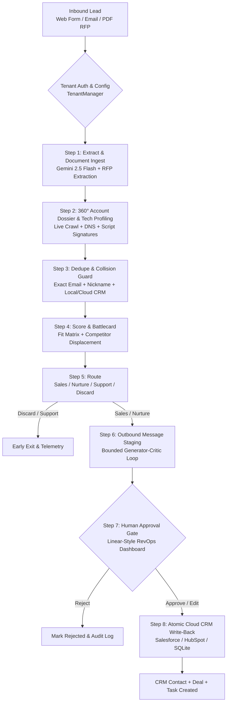

# LeadFlow Enterprise SaaS Architecture

## 1. System Vision
LeadFlow is an autonomous RevOps intelligence platform designed for B2B enterprises. It transforms unstructured inbound pipeline inquiries, vendor evaluations, and RFP documents into qualified, scored, and competitive sales opportunities while synchronizing bidirectionally with enterprise CRM stacks (Salesforce REST, HubSpot API v3, and SQLite).

---

## 2. Inputs & Outputs
- **Inputs**:
  - Raw inbound text (inbound email, web-to-lead form, webhook payload).
  - Omnichannel procurement documents (PDF base64, RFP questionnaires, Markdown specs).
  - Authenticated tenant key (`lf_live_...` or Bearer token).
- **Outputs**:
  - 360° Account Dossier (crawled metadata, technology fingerprint, estimated scale).
  - Dynamic Sales Battlecard (competitor displacement playbook, objection tracks, 3-touch cadence).
  - Atomic Cloud CRM records (Contact, Deal/Opportunity, Interaction Task).
  - Immutable audit trail logging human decisions and pipeline transitions.

---

## 3. End-to-End Enterprise Flow

---

## 4. Pipeline Stages & Architectural Design Decisions

| Stage | Execution Mechanism | Architectural Justification |
|---|---|---|
| **Tenant Routing** | In-memory lookup / SQLite auth | Sub-millisecond tenant resolution with logical credential isolation. |
| **Document Ingestion** | Regex & header extraction | Zero-cost parsing for seat count, budget, compliance (SOC 2, FedRAMP, HIPAA), and deadlines. |
| **Extraction** | LLM schema-constrained call | Pydantic validation handles unstructured edge cases and prompt injection flags. |
| **Account Dossier** | Concurrent HTTP crawl + DNS profiler | Identifies web stack, DNS MX/SPF email infrastructure, and tech fingerprints (Segment, Datadog). |
| **Deduplication** | Exact + Normalized SQL & Jaccard index | 100% deterministic duplicate resolution with zero token expenditure and zero false merges. |
| **Scoring & Battlecard** | Rule-matrix + Competitor intelligence | Transparent 0-100 score + instant displacement playbook (objections, trap questions, 3-touch cadence). |
| **Routing** | Priority threshold classifier | Predictable tier assignment: Sales Escalation, Nurture, Support, or Discard. |
| **Outbound Drafting** | Bounded Generator-Critic loop (max 2 iter) | Strict 4-pillar quality checks (relevance, conciseness, call-to-action, grounded claims). |
| **Human Review** | HITL gate in Linear-style dashboard | Zero unapproved writes. Operations reps inspect dossier, battlecard, and edit draft before commit. |
| **Atomic Write-Back** | Cloud CRM REST adapters | ACID-compliant rollback semantics with idempotency keys across Salesforce, HubSpot, and SQLite. |

---

## 5. Security & Isolation Safeguards
1. **Zero Unapproved Writes**: Cloud CRM adapters are completely inaccessible to LLM execution contexts; only the post-approval writeback module executes mutations.
2. **Multi-Tenant Logical Isolation**: Separate API keys, isolated CRM credentials, and distinct routing thresholds per tenant.
3. **Prompt Injection Defense**: Inbound texts and attached document bodies pass through signature scanners before reaching prompt context.
4. **Denial-of-Wallet Guards**: Strict upper bounds of 15 pipeline steps and $0.10 total cost per execution trace.
5. **No AI Tropes in UI**: Restrained Linear/Stripe design standard for high-density enterprise operations.
