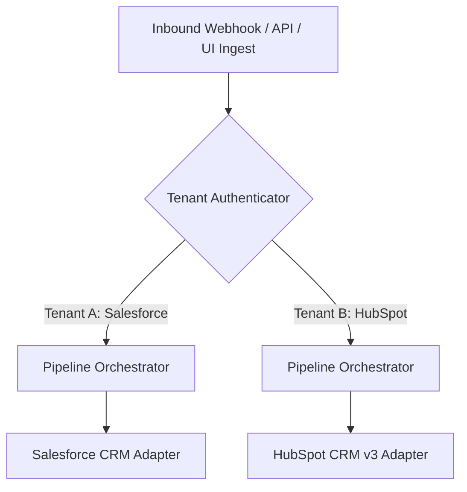

# LeadFlow Enterprise SaaS & Multi-Tenancy Architecture Guide

LeadFlow is an enterprise-grade autonomous RevOps and Sales Intelligence platform engineered for B2B multi-tenant SaaS deployments. It bridges unstructured inbound pipeline traffic (emails, web forms, RFP documents, vendor evaluations) with enterprise CRM systems (Salesforce, HubSpot, SQLite) through deterministic safeguards and deep competitive intelligence.

---

## 1. Multi-Tenant Architecture & TenantManager

LeadFlow provides strict logical data isolation across tenants using `TenantManager`:

- **Tenant Isolation**: Each tenant (`TenantConfig`) maintains dedicated API keys, CRM credentials, battlecard playbooks, and routing rules.
- **Tenant Key Authentication**: Tenant requests to webhook endpoints are authorized via unique API keys (`leadflow_sk_...`) or Bearer tokens.
- **Zero Cross-Tenant Leakage**: CRM adapters, local caches, and audit logs are dynamically scoped to the authenticated tenant.

### Architecture Schema


### Tenant Configuration Structure
```python
@dataclass
class TenantConfig:
    tenant_id: str
    organization_name: str
    api_key: str
    crm_type: str  # "salesforce" | "hubspot" | "sqlite"
    crm_credentials: dict[str, Any]
    battlecard_settings: dict[str, Any]
    routing_thresholds: dict[str, float]
    created_at: str
```

---

## 2. Enterprise CRM Adapters

LeadFlow abstracts CRM operations behind a unified `CRMClient` protocol, enabling seamless swapping between native mock implementations and live cloud enterprise CRMs:

### Salesforce Adapter (`SalesforceCRM`)
- **API Spec**: Salesforce REST API v59.0 (SObject & Composite Resource).
- **Authentication**: OAuth 2.0 Client Credentials or Session Bearer Token with token refresh handling.
- **Object Mapping**:
  - `Contact`: First/Last Name, Email, Title, Company Name, LeadSource (`"LeadFlow Inbound"`).
  - `Opportunity`: Linked Deal record (`StageName: "Qualification"`, `Amount`, `CloseDate`).
  - `Task`: Historical interaction and qualification audit logs.

### HubSpot Adapter (`HubSpotCRM`)
- **API Spec**: HubSpot CRM API v3 (`crm/v3/objects/contacts`, `crm/v3/objects/deals`).
- **Associations API**: Atomic association between Contact and Deal records (`toObjectId`, `associationCategory: "HUBSPOT_DEFINED"`).
- **Engagements**: Logs sales activities via HubSpot Notes and Communications API.

---

## 3. Autonomous Web Intelligence & Technographic Profiler

Before scoring an inbound lead, LeadFlow autonomously crawls the prospect domain and fingerprints its infrastructure:

### Technographic DNS & Script Profiling (`TechnographicProfiler`)
- **DNS Records**: Inspects `MX` and `TXT` (SPF) records to identify email providers (Google Workspace, Microsoft 365, Mimecast, Proofpoint).
- **Frontend Stack Fingerprinting**: Regex script and header inspection identifies:
  - Analytics & CDP: Segment, Mixpanel, Google Tag Manager.
  - RevOps & CRM: HubSpot Tracking, Salesforce Pardot, Marketo.
  - Infrastructure: Cloudflare, AWS CloudFront, Datadog RUM.

### 360° Account Dossier (`AccountDossier`)
- Aggregates meta tags (OpenGraph, description, titles), tech stack, security posture, estimated employee band, and market segment into an immutable intelligence object.

---

## 4. Competitive Displacement Playbooks & Battlecards

When an inbound lead mentions an incumbent competitor (e.g. CrowdStrike, SentinelOne, Outreach, Salesloft, Snowflake, Databricks):

1. **Competitor Detection**: Identifies incumbent vendors from email context or RFP RFP specifications.
2. **Displacement Positioning**:
   - Primary differentiator and architectural advantage.
   - Trap questions to expose incumbent operational friction.
   - Customer proof point and migration case study.
   - High-impact objection responses.
3. **Multi-Touch Outbound Cadence**:
   - **Touch 1 (Day 0)**: Strategic inquiry addressing core displacement hook.
   - **Touch 2 (Day 3)**: Tactical technical teardown and architectural contrast.
   - **Touch 3 (Day 7)**: Executive proof point and migration ROI calculator.

---

## 5. Omnichannel RFP & Document Ingestion

LeadFlow accepts raw RFP documents, procurement questionnaires, and vendor evaluation forms (PDF, TXT, Markdown):

- **Procurement Extraction**: Extracts operational requirements, seat counts, target budget, compliance mandates (SOC 2, ISO 27001, HIPAA, GDPR), and submission deadlines.
- **Urgency Scoring**: Multiplies procurement urgency and enterprise scale to accelerate hot deals straight to executive review.

---

## 6. SaaS Webhook Ingestion API

Inbound leads can be submitted directly via external webhooks:

### Endpoint
```http
POST /api/v1/ingest?tenant_key=leadflow_sk_live_123456
Content-Type: application/json
```

### Request Body
```json
{
  "source": "web_form",
  "text": "Hi team, we are evaluating alternatives to CrowdStrike for 850 endpoints across our healthcare network. Budget is $120k.",
  "document_base64": null,
  "document_filename": null
}
```

### Response
```json
{
  "status": "success",
  "lead_id": "lead-89a1",
  "tenant_id": "tenant-acme",
  "score": 92.5,
  "tier": "Tier 1 - Enterprise",
  "route": "Sales Escalation",
  "competitor_detected": "CrowdStrike",
  "dossier": {
    "domain": "healthcare.org",
    "technographics": ["Microsoft 365", "Cloudflare"]
  },
  "requires_approval": true
}
```

---

## 7. Linear/Stripe-Style RevOps Dashboard

The dashboard (`leadflow.ui.app`) is designed specifically for enterprise RevOps teams:
- **No AI Tropes**: Zero sparkle emojis, no purple gradients, no robot avatars.
- **High Data Density**: Obsidian/zinc Linear palette (`#090a0f`, `#12151e`, `#181d2a`).
- **Telemetry Waterfall**: Real-time display of token consumption, step latency, and dollar cost per run.
- **Human Gate**: Full message draft staging with inline editing and atomic write-back.
